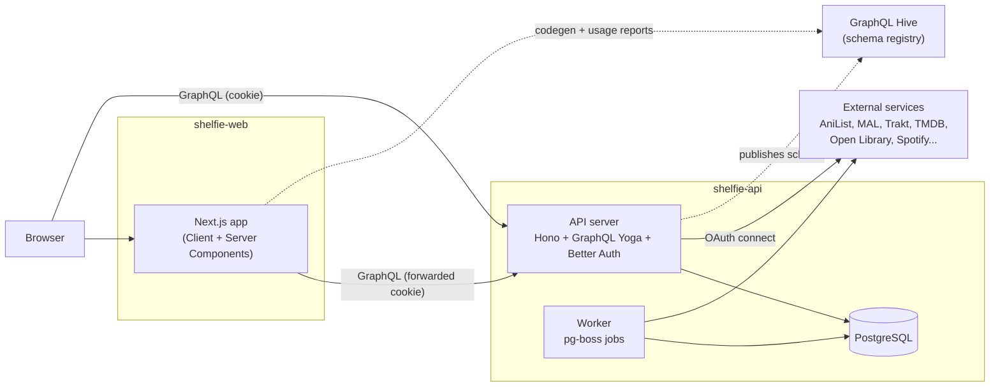

# System overview

## Purpose

One library for everything a person reads, watches and listens to, regardless of medium, with progress tracking, ratings, history, and imports from existing trackers. Social features (public profiles, following, feeds) are planned for later; today's design keeps the door open for them without building them.

## Components

| Component | Role |
| --- | --- |
| Next.js app | UI. Client Components call the API from the browser; Server Components call it from the Next.js server and must forward the session cookie. |
| API server | GraphQL for all client data; plain REST for OAuth callbacks, file uploads and webhooks. Hosts Better Auth for login. |
| Worker | Runs imports and metadata refreshes as background jobs. The only component that decrypts connected-account tokens. |
| PostgreSQL | Single source of truth, including the job queue. |
| GraphQL Hive | Stores every schema version and the frontend's operations; powers breaking-change checks. |
| External services | Catalog metadata and users' existing lists. |

## Domain model

The core idea is to separate **what a thing is** from **a user's relationship to it**.

- **Work** — a canonical item in one medium (the *Frieren* anime and the *Frieren* manga are two Works). Medium-specific fields live in a `metadata` jsonb column.
- **Media type** — stored as data, not an enum. Each type belongs to one **consumption mode**: read (comic, book, manga, manhwa, webtoon, novel...), watch (movie, series, anime, miniseries, novela...) or listen (podcast, audiobook, album...).
- **Work relation** — adaptation, sequel, audiobook-of, and so on.
- **External ID** — maps a Work to AniList, TMDB, Open Library... Unique per source, which makes imports idempotent.
- **Library entry** — one per user per Work: status, progress (current / total / unit), rating, dates, repeat count, notes, visibility.
- **Activity event** — append-only log of meaningful changes. Powers history and stats now, the social feed later.
- **Connected account** — an import source (AniList, MyAnimeList, Trakt, IMDb, Spotify...), stored separately from login identities, with encrypted tokens.

## Authentication and authorization

- Login is OAuth/OpenID Connect (Google, Discord; Apple before an iOS app) through Better Auth, self-hosted in the API. Sessions are HttpOnly, Secure, SameSite=Lax cookies.
- Connected import accounts use their own OAuth flows and never share tables with login identities.
- Authorization is enforced in the API: every resolver checks ownership, and all visibility decisions go through one shared rule.

## Environments and domains

| Environment | Frontend | API |
| --- | --- | --- |
| Local | `http://localhost:3001` | `http://localhost:3000` |
| Production | `https://app.<domain>` | `https://api.<domain>` |

Both production hosts must share one registrable domain so the auth cookie is first-party. Never deploy either side on a hosting provider's default domain. See [ADR 0006](adr/0006-self-hosted-auth-with-better-auth.md) and the [API contract](api-contract.md#domains-and-cookies).
